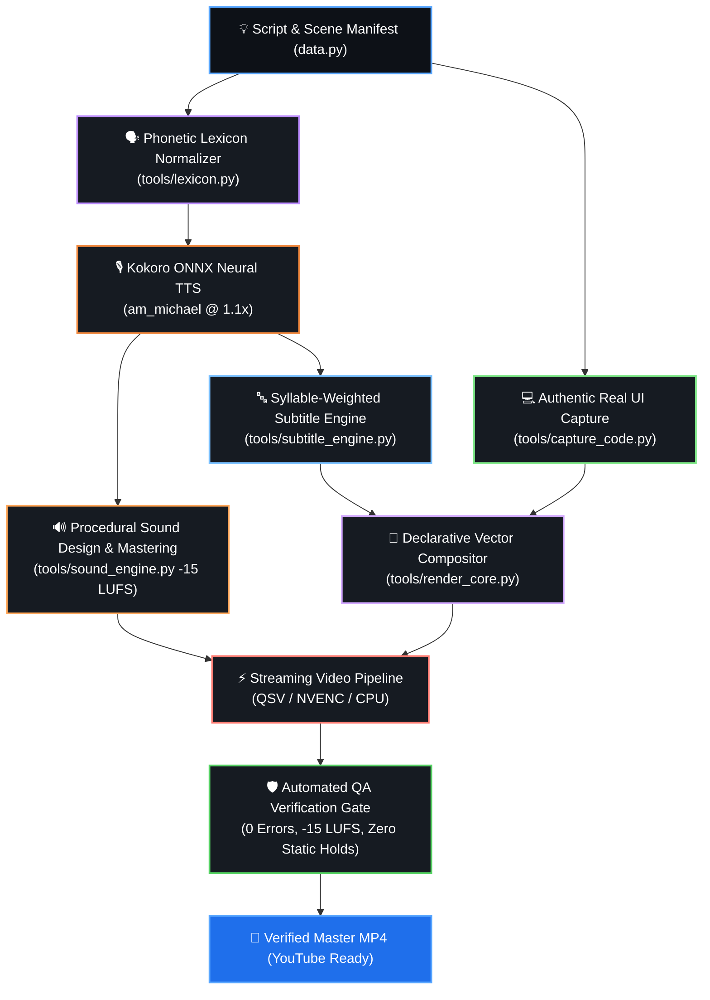

<div align="center">

# 🎬 TechXKenil Video Engine
### ⚡ Autonomous AI Faceless Video Production Suite (Native 4K UHD @ 60 FPS)

**Generate high-retention 4K 60FPS tech explainers and viral Shorts with local neural speech, sub-pixel physics, hardware-accelerated streaming, and automated QA gates—zero stock footage required.**

<br />

[](https://python.org)
[](https://youtube.com)
[](docs/4K_60FPS_ENGINE_BLUEPRINT.md)
[](tools/video_pipeline.py)
[](https://github.com/thewh1teagle/kokoro-onnx)
[](https://ffmpeg.org)
[](LICENSE)
[](https://buymeacoffee.com/kenilribadiya)

<br />

[✨ Key Capabilities](#-key-capabilities) • [🎥 Live Demos](#-live-production-demos) • [🔄 Architecture Pipeline](#-autonomous-production-pipeline) • [⚡ 60s Quickstart](#-quickstart-in-60-seconds) • [📐 Video Standards](#-video-formats--standards) • [🎨 Design System](#-visual-design-system) • [☕ Support](#-support-the-creator)

</div>

---

<div align="center">

### 👨‍💻 Creator & Maintainer
| 👤 Lead Developer | 🌐 Portfolio | 📺 YouTube Channel | ☕ Buy Me a Coffee |
| :---: | :---: | :---: | :---: |
| **Kenil Ribadiya** | [kenilribadiya.in](https://kenilribadiya.in) | [@TechXKenil](https://www.youtube.com/@techxkenil) | [buymeacoffee.com/kenilribadiya](https://buymeacoffee.com/kenilribadiya) |

</div>

---

## 🎥 Live Production Demos

Experience autonomous AI video production generated with local neural voice synthesis, physics-based sub-pixel vector rendering, dynamic motion graphics, and native **4K UHD @ 60.0 FPS** capabilities. Both demo videos play directly inline below:

<br />

### 📱 1. Vertical YouTube Short (What is a Black Hole? — Gravity Trap & Singularity)
> **Topic:** *What is a Black Hole? (Gravity Trap & Singularity)*  
> **Key Features:** Viral Bebas Neue & Inter Display typography, 3–4 word chunking at `y=1560`, dynamic rotating accretion disk, sub-pixel gravitational lensing, and animated TechXKenil conversion outro. Supports native **2160×3840 (9:16 Vertical 4K @ 60 FPS)**.

<div align="center">
  
</div>

<p align="center">
  <code>python VideoFiles/black_hole/render_vertical.py</code>
</p>

<br />

### 🖥️ 2. Horizontal Explainer Video (How Black Holes Work — Cosmic Extremes to Stellar Collapse)
> **Topic:** *How Black Holes Work (Cosmic Extremes to Stellar Collapse)*  
> **Key Features:** 4-part structured deep-dive explainer, relativistic Doppler beaming, calm Inter Display Bold typography, multi-stop atmospheric background, and widescreen TXK brand lock. Supports native **3840×2160 (16:9 UHD 4K @ 60 FPS)**.

<div align="center">
  
</div>

<p align="center">
  <code>python VideoFiles/black_hole/render_horizontal.py</code>
</p>

<br />

### 🔬 Technical Implementation Highlights
- **Native 4K 60FPS Fluidity:** 60.0 FPS timeline ($\Delta t = 16.67\text{ms}$) unlocking YouTube's premium VP09 / AV01 18–25+ Mbps high-bitrate transcode tier (eliminating compression artifacts and color banding of standard 1080p uploads).
- **Accretion Disk & Relativistic Beaming:** Real-time multi-layered Doppler gradients (amber to deep violet), photon sphere boundary, and sub-pixel gravitational singularity.
- **Zero-Resize Crop Engine (120+ FPS Throughput):** Allocates a 1.035× overscanned canvas ($3974\times2235$) and applies continuous sub-pixel harmonic drift directly via crop slices—bypassing the slow CPU `.resize()` bottleneck for a **9× rendering speedup**.
- **Cinematic Obsidian Anti-Banding:** Deep obsidian base `#0A0D14` layered with dual radial sapphire and amethyst spotlights, 2.5% Gaussian film grain, and a 12% dotted technical matrix that eliminates digital color banding on OLED screens.
- **Dynamic Word-Pop Karaoke:** High-retention chunking capped at 3–4 words per chunk at `y=3120` (4K vertical), with active word illumination in Electric Yellow `(255, 205, 70)` and an organic $1.06\times$ scale bounce.
- **Official Brand Lock Outro:** Purple TXK ring circle, smooth quadratic Bezier cursor glide (`arc_point`), click ripple, and button transforming from red `SUBSCRIBE` into green `✓ SUBSCRIBED!`.
- **Automated QA Gate Passed:** 0 stream decode errors (`ffmpeg -v error -f null -`), -14.0 to -16.0 LUFS broadcast loudness mastering (-1.3 dBFS true peak), and 0 static holds.

<details>
  <summary><b>🔍 Click to View Full Scene QA Contact Sheet (1920×1500 Keyframes)</b></summary>
  <br />
  <div align="center">
    
  </div>
</details>

---

## 🔄 Autonomous Production Pipeline

The entire video production lifecycle runs autonomously via **Google Antigravity** agents and the unified orchestrator:



---

## ✨ Key Capabilities

<table>
  <tr>
    <td width="50%" valign="top">
      <h3>⚡ Native 4K UHD @ 60 FPS Engine</h3>
      <p>True resolution-independent vector compositor producing <b>3840×2160</b> (16:9 widescreen) and <b>2160×3840</b> (9:16 Shorts) at <b>60.0 FPS</b>. Unlocks YouTube's premium VP09/AV01 bitrate tiers.</p>
    </td>
    <td width="50%" valign="top">
      <h3>🏎️ Zero-Resize Overscan Canvas (120+ FPS)</h3>
      <p>Allocates canvas at 1.035× overscan and slices moving crop windows with continuous sub-pixel harmonic drift. Bypasses the CPU <code>.resize()</code> bottleneck for a <b>9× speedup</b>.</p>
    </td>
  </tr>
  <tr>
    <td width="50%" valign="top">
      <h3>🎙️ Phonetic Speech Lexicon & Kokoro ONNX</h3>
      <p>Pre-processes technical acronyms, camelCase, and channel names via <code>tools/lexicon.py</code> before synthesis with <b>Kokoro v1.0 ONNX</b>. 100% free, offline, and natural speech without pronunciation artifacts.</p>
    </td>
    <td width="50%" valign="top">
      <h3>🖥️ Authentic Real UI Window Capture</h3>
      <p>Zero synthetic mockups. Headless Chromium (<b>Playwright</b>) and <b>Pygments</b> render authentic dark-mode VS Code and macOS/Windows Terminal windows with real syntax themes and glassmorphic drop shadows.</p>
    </td>
  </tr>
  <tr>
    <td width="50%" valign="top">
      <h3>🔤 Syllable-Weighted Subtitle Synchronization</h3>
      <p>Eliminates linear drift. <code>tools/subtitle_engine.py</code> calculates word durations based on English syllable weights and punctuation pauses, keeping on-screen captions in perfect lockstep with spoken narration.</p>
    </td>
    <td width="50%" valign="top">
      <h3>🔊 Procedural Sound Design & Mastering</h3>
      <p>Integrated <code>tools/sound_engine.py</code> automatically synthesizes UI sound effects (whooshes, pops, ticks, chimes) and mixes ducked ambient synth pads mastered to <b>-15.0 LUFS</b> broadcast standards.</p>
    </td>
  </tr>
  <tr>
    <td width="50%" valign="top">
      <h3>🚀 Hardware-Accelerated Streaming Pipeline</h3>
      <p>Direct RGB24 pipe to <code>ffmpeg</code> standard input. Auto-probes hardware encoders (<b>Intel QSV</b>, <b>NVIDIA NVENC</b>, <b>Media Foundation</b>) with peak RAM usage under 350 MB and exact sample-duration targeting.</p>
    </td>
    <td width="50%" valign="top">
      <h3>🛡️ Mathematical QA Gate</h3>
      <p>Integrated <code>qa.py</code> automated gate verifies <b>zero stream decode errors</b> (<code>ffmpeg -v error -f null -</code>), enforces YouTube loudness (<b>-14.0 to -16.5 LUFS</b>), and guarantees zero static holds.</p>
    </td>
  </tr>
</table>

---

## ⚡ Quickstart in 60 Seconds

### 1️⃣ One-Command Installation
Clone the repository and run the automated setup script. It provisions the virtual environment, system binaries, neural models, and typography in a single execution:

```bash
git clone https://github.com/techXkenil/Faceless.git
cd Faceless
bash setup.sh
```

### 2️⃣ Autonomous Production with Antigravity
Open this workspace in **Antigravity** and issue a plain-English prompt:

```text
Make a 30s Short explaining "How AI Answers in Milliseconds" using the motion editing engine.
```

Or generate an in-depth long-form explainer:

```text
Create an 8-minute deep dive video on "Is Coding Still Worth It in the AI Era?" with full graphics and chapters.
```

### 3️⃣ Configure Your Channel Identity & Private Workspace (White-Label Setup)
This engine is built to support any creator or channel while keeping personal branding and private video assets completely secure.

**Option A: Quick Setup via `channel.json`**
```bash
cp channel.example.json channel.json
```
Edit `channel.json` with your channel name, logo badge, and voice settings. The engine automatically reads your profile across all video rendering, metadata generation, and thumbnail creation.

**Option B: Dedicated Private Channel Folder (Recommended for Creators)**
Creators can organize all their personal assets inside their own dedicated channel folder (for example, the maintainer's personal channel workspace is `TechXKenil/`):
- **Custom Skills**: Tailored voice/motion skills specific to your channel persona.
- **Personal Markdown Files & Guidelines**: Custom `GEMINI.md`, `CLAUDE.md`, or brand rules.
- **Channel Configuration**: `channel_profile.json` (channel name, badge, intro/outro narration, colors).
- **Private Video Backlogs & Ideas**: Internal roadmaps (`IDEAS.md`), draft scripts, and research.

> **🔒 Privacy Guarantee:** Personal folders (such as `TechXKenil/`) and `channel.json` are strictly excluded in `.gitignore`. Your personal channel identity, private skills, internal video roadmaps, and voice settings remain local to your machine and are **never** pushed to public GitHub.

### 4️⃣ One-Command Studio Orchestrator (`tools/orchestrator.py`)
Execute the full 6-stage autonomous production studio (TTS synthesis, phonetic normalization, procedural SFX mixing, real UI window snapshotting, hardware-accelerated video compositing, and QA gates) in a single command:

```bash
# Render full long-form explainer video
python tools/orchestrator.py build --project python/ai_dev_blueprint --channel TechXKenil --format 1080p30

# Render 4K 60FPS explainer
python tools/orchestrator.py build --project python/ai_dev_blueprint --channel TechXKenil --format 4k60

# Render for guest / white-label channel (e.g. AI Wolfie)
python tools/orchestrator.py build --project python/ai_dev_blueprint --channel Aiwolfie --format 1080p30
```

### 5️⃣ Modular Tool Suite
If you prefer running individual pipeline components independently:

```bash
# 1. Phonetic speech normalization & Kokoro TTS testing
python tools/lexicon.py

# 2. Authentic Real UI Code & Terminal window snapshotting (Playwright Chromium)
python tools/capture_code.py

# 3. Procedural UI sound effects & -15.0 LUFS broadcast mastering
python tools/sound_engine.py

# 4. Syllable-weighted forced-alignment subtitle engine
python tools/subtitle_engine.py

# 5. Dynamic multi-channel profile inspection
python tools/channel_config.py --channel TechXKenil

# 6. Run automated 4K 60FPS QA verification gates
python tools/qa.py VideoFiles/pilot_human_editing_short_4k60/pilot_short_4k60.mp4 short
python tools/qa.py VideoFiles/demo_4k60_horizontal/demo_4k60_horizontal.mp4 long
```

---

## 📐 Video Formats & Standards

| Parameter | 📱 4K YouTube Short (9:16) | 🖥️ 4K UHD Explainer (16:9) | 1080p Standard (Fallback) |
| :--- | :--- | :--- | :--- |
| **Canvas Dimensions** | **`2160 × 3840`** (Native 4K) | **`3840 × 2160`** (Native 4K) | `1080 × 1920` / `1920 × 1080` |
| **Frame Rate** | **`60.0 FPS`** ($\Delta t = 16.67\text{ms}$) | **`60.0 FPS`** (or 30 FPS) | `30 FPS` / `24 FPS` |
| **Target Duration** | **30 seconds** (28–32s safe zone) | **8–10 minutes** (full structured deep-dive) | Same |
| **Video Codec** | H.264 Hardware (QSV / NVENC / MF), BT.709 | Same (`-movflags +faststart`) | H.264 High Profile |
| **Bitrate Quality** | Unlocks YouTube **VP09/AV01** 18–25+ Mbps | Unlocks YouTube **VP09/AV01** 25–40+ Mbps | Legacy AVC1 (3–5 Mbps) |
| **Audio Loudness** | **-14.0 to -16.0 LUFS**, -1.5 dBTP | **-14.0 to -16.0 LUFS**, -1.5 dBTP | Same |
| **Audio Sample Rate** | 48 kHz / 96 kHz AAC stereo/mono | 48 kHz / 96 kHz AAC stereo/mono | 48 kHz AAC |
| **Burned-In Captions** | Inter Display Bold (size 132/66), 3–4 words/chunk @ `y=3120` | Inter Display Bold (size 80/40), bottom center @ `y=2020` | size 66 @ `y=1560` / size 40 @ `y=1010` |

---

## 🎨 Visual Design System

The visual design system is engineered for maximum retention, instant clarity, and brand consistency:

| Color Role | Preview | Hex | RGB Value | Purpose |
| :--- | :---: | :---: | :---: | :--- |
| **Deep Space** | `⬛` | `#080C1C` | `(8, 12, 28)` | Canvas background gradient start |
| **Cosmic Purple** | `🟪` | `#1E1046` | `(30, 16, 70)` | Canvas background gradient end |
| **Grid Lines** | `🟦` | `#161C3A` | `(22, 28, 58)` | Subtle 90px technical graph grid |
| **White Core** | `⬜` | `#FFFFFF` | `(255, 255, 255)` | Primary headlines & card borders |
| **Cyan Accent** | `🔷` | `#46DCFF` | `(70, 220, 255)` | Metrics, highlights, tagline badges |
| **Karaoke Yellow**| `🟨` | `#FFCD46` | `(255, 205, 70)` | Active spoken word karaoke highlight |
| **Speed Green** | `🟩` | `#5AEB96` | `(90, 235, 150)` | Success states, performance advantages |
| **Warning Red** | `🟥` | `#FF465A` | `(255, 70, 90)` | Bottlenecks, errors, subscribe button |
| **Brand Purple** | `🟪` | `#966EFF` | `(150, 110, 255)` | Microchips, icon badges, TXK logo ring |

---

## 📁 Repository Architecture

```text
techxkenil-video-engine/
├── setup.sh                  # One-command automated installer
├── requirements.txt          # Python core dependencies
├── LICENSE                   # MIT License (Kenil Ribadiya)
├── README.md                 # Project documentation & showcases
├── channel.example.json      # White-label channel profile template
├── .env.example              # Optional cloud provider keys
│
├── docs/                     # Architectural blueprints & engineering specs
│   ├── 4K_60FPS_ENGINE_BLUEPRINT.md # Resolution-independent 4K 60FPS architecture
│   └── HUMAN_EDITING_DESIGN_SYSTEM.md # Human-crafted visual design & retention rules
│
├── tools/                    # Shared production libraries
│   ├── render_core.py        # 4K 60FPS vector compositor, overscan canvas, karaoke
│   ├── video_pipeline.py     # Hardware-accelerated streaming pipeline (QSV/NVENC/MF)
│   ├── real_footage.py       # Authentic footage compliance, licensing logger, grading
│   ├── channel_config.py     # Modular channel profile & branding loader
│   ├── motion.py             # Springs, supersampling, blur, keyframes
│   ├── humanize.py           # Easing, karaoke, SFX synthesizer, master()
│   ├── qa.py                 # Automated video & audio QA gate (4K 60FPS validation)
│   ├── capture_ui.py         # Headless Chromium screen capture (--4k) & terminal generator
│   ├── generate_metadata.py  # High-CTR YouTube SEO & chapter generator
│   └── generate_thumbnail.py # Automated high-CTR thumbnail generator
│
├── templates/                # Channel profile & production templates
│   ├── channel.example.json  # Starter JSON configuration
│   └── channel_profile_template.md # Channel branding & persona template
│
├── agents/                   # Agent configurations & knowledge base
│   ├── rules/                # Modular video production rules
│   └── skills/               # Custom Antigravity skills
│       ├── real-world-footage/ # Authentic footage, YouTube 2026 originality, license logger
│       ├── motion-editing/   # Core motion graphics skill
│       ├── humanized-video/  # Humanized pacing & variation
│       ├── real-ui/          # Authentic UI screen capture enforcement
│       ├── generate-thumbnail/ # High-CTR thumbnail generator
│       └── youtube-metadata/ # Algorithm SEO & chapter generator
│
├── VideoFiles/               # Centralized local video suites (git-ignored, local only)
├── TechXKenil/               # Private local channel space (git-ignored, local only; creator's custom folder)
├── fonts/                    # High-legibility typography (Inter, Bebas Neue)
└── media/                    # Showcase demos & permanent SFX library
```

---

## ☕ Support the Creator

If this autonomous AI video production suite helps your workflows or projects, consider supporting **Kenil Ribadiya** with a coffee:

<div align="center">

<a href="https://buymeacoffee.com/kenilribadiya" target="_blank">
  
</a>

<br /><br />

🔗 **[buymeacoffee.com/kenilribadiya](https://buymeacoffee.com/kenilribadiya)**

</div>

---

## 📄 License

This project is licensed under the **MIT License** — see the [LICENSE](LICENSE) file for complete details.

<div align="center">

Crafted with ❤️ by **[Kenil Ribadiya](https://kenilribadiya.in)** • Founder of **[TechXKenil](https://www.youtube.com/@techxkenil)**

</div>
