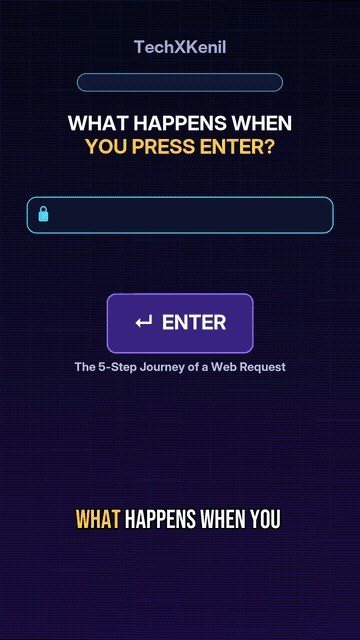

# 🎬 TechXKenil — Autonomous AI Faceless Video Production Suite

[](LICENSE)
[](https://python.org)
[](https://deepmind.google)
[](https://github.com/thewh1teagle/kokoro-onnx)
[](https://ffmpeg.org)
[](https://buymeacoffee.com/kenilribadiya)

> **An open-source, fully autonomous AI video production engine driven by Google Antigravity AI agents.**  
> Create production-ready vertical YouTube Shorts (1080×1920) and long-form tech explainers (1920×1080) with zero stock footage, local neural voice synthesis, physics-based motion graphics, and automated loudness mastering.

---

## 👨‍💻 Main Contributor
- **Kenil Ribadiya**
- **Portfolio:** [kenilribadiya.in](https://kenilribadiya.in)
- **Channel:** [TechXKenil](https://www.youtube.com/@techxkenil) (AI, Tech & Code)
- **Support:** [buymeacoffee.com/kenilribadiya](https://buymeacoffee.com/kenilribadiya)

---

## ✨ Features

- 🤖 **Agent-First Workflow:** Pre-configured for **Google Antigravity** agents to write scripts, generate narration, animate frames, mix audio, and run QA gates autonomously.
- 🎙️ **100% Free Local Neural Voice (Kokoro ONNX):** Studio-grade TTS running locally via `kokoro-onnx` (`am_michael` at 1.1× speed). No API keys or subscriptions required.
- 🖥️ **Real UI Screen Capture Engine (`capture_ui.py`):** Never draws synthetic fake mockups. Uses headless Chromium (Playwright) to capture live websites (GitHub, Hugging Face, ChatGPT) and renders authentic system terminals with genuine monospace typography.
- 🎨 **Physics-Based Motion Graphics (`motion.py`):**
  - **Spring Physics (`spring`):** Natural dampening with ~4% overshoot.
  - **2× Sub-Pixel Supersampling (`SS`):** Anti-aliased vector rendering via Lanczos downsampling—zero pixel snapping or jagged edges.
  - **Kinetic Typography (`word_pop`):** Word-by-word slide-up and fade reveals.
  - **Smooth Numerical Counters (`count_up`):** Quartic ease-out ticker animations.
  - **Temporal Motion Blur (`blur_layer`):** Sub-frame accumulation on high-speed movements.
- 🔤 **Viral Shorts Typography:** Clean Bebas Neue captions with calibrated black stroke boundaries (`stroke_fill=(0, 0, 0)`) and real-time word-level karaoke highlighting.
- 🔊 **Automated Sound Design & Loudness Gate:**
  - Dynamic SFX mixing (`whoosh`, `pop`, `tick`, `chime`) ducked beneath spoken dialogue.
  - Automated two-pass `loudnorm` mastering to YouTube reference levels (**-14.0 LUFS**, -1.5 dBTP, 48 kHz AAC).
- 🛡️ **Automated QA Validation Gate (`qa.py`):** Every video is mathematically checked for zero decode errors, loudness compliance, and absence of static visual holds.

---

## 🎥 Live Production Demos

Experience autonomous AI video production generated with local neural voice synthesis, Pillow sub-pixel vector rendering, and dynamic motion graphics. Both demo videos play directly inline below:

### 📱 1. Short 6: What Happens When You Press Enter? (1080×1920 @ 30 FPS)
> **Topic:** *The 5-Step Journey of a Web Request (DNS, HTTPS Padlock, HTTP Payload, DOM Paint)*  
> **Key Features:** Genuine browser Omnibox, 3D animated Enter key with ripple, TLS padlock lock, streaming HTML/CSS/JS assets, and Bebas Neue Karaoke captions.

<div align="center">
  
</div>

<p align="center">
  <code>python python/press_enter_website/render_press_enter.py</code>
</p>

<br>

### 🖥️ 2. 40s Horizontal Explainer Video (1920×1080 @ 30 FPS)
> **Topic:** *How Black Holes Work (Cosmic Extremes to Stellar Collapse)*  
> **Key Features:** 4-part structured explainer, relativistic Doppler beaming, Inter Display Bold calm subtitles, and widescreen TXK brand lock.

<div align="center">
  
</div>

<p align="center">
  <code>python python/black_hole/render_horizontal.py</code>
</p>

### 🔬 Technical Implementation Highlights
- **Accretion Disk & Relativistic Beaming:** Real-time multi-layered Doppler gradients (amber to deep violet), photon sphere boundary, and sub-pixel gravitational singularity.
- **Viral Shorts Typography:** High-retention Bebas Neue Bold (size 78) chunked strictly into 3–4 words per chunk at `y=1560`, with active word karaoke highlighting in yellow and zero margin overflows.
- **Calm Widescreen Subtitles:** Inter Display Bold (size 38) chunked into 6–7 words at `y=1000` with 540px+ breathing room on each side.
- **Official Brand Lock Outro:** Purple TXK ring circle, smooth quadratic Bezier cursor glide (`arc_point`), click ripple, and button transforming from red `SUBSCRIBE` into green `✓ SUBSCRIBED!`.
- **Automated QA Gate Passed:** 0 decode errors (`ffmpeg -v error -f null -`), -15.2 LUFS loudness mastering, and 0 static holds.

---

## ⚡ Quickstart: The One Command

Clone the repository and run the setup script. It configures the entire virtual environment, dependencies, neural models, and typography in one go:

```bash
git clone https://github.com/<your-username>/techxkenil-video-engine.git
cd techxkenil-video-engine
bash setup.sh
```

### 🤖 Running with Antigravity
Open this repository inside **Antigravity**. You can simply prompt the agent:

```text
Make a 30s Short explaining "How AI Answers in Milliseconds" using the motion editing engine.
```

Or for long-form content:

```text
Create an 8-minute deep dive video on "Is Coding Still Worth It in the AI Era?" with chapters and full graphics.
```

The Antigravity agent will automatically:
1. Break down the script into timestamped beats.
2. Synthesize audio with Kokoro ONNX and calculate word boundaries.
3. Design and animate the scene layouts with spring motion and supersampling.
4. Master loudness and verify zero decode errors via `qa.py`.
5. Deliver the MP4 alongside high-CTR YouTube metadata and thumbnail prompts.

---

## 📐 Video Formats & Standards

| Parameter | YouTube Short | Long Explainer Video |
|---|---|---|
| **Resolution** | 1080 × 1920 (Vertical 9:16) | 1920 × 1080 (Horizontal 16:9) |
| **Frame Rate** | 30 FPS | 24 FPS |
| **Duration** | **30 seconds** (28–32s safe) | **8–10 minutes** |
| **Video Codec** | H.264 High Profile, yuv420p, BT.709 color-tagged | Same |
| **Audio Standard** | -14.0 LUFS (±1 LUFS), -1.5 dBFS True Peak, 48 kHz AAC | Same |
| **Captions** | Bebas Neue, Size 82, 3.5px black outline, centered at y=1560 | Inter Bold, Size 40, centered at bottom |

---

## 📁 Repository Architecture

```text
techxkenil-video-engine/
├── setup.sh                  # One-command automated installer
├── requirements.txt          # Python core dependencies
├── LICENSE                   # MIT License (Kenil Ribadiya)
├── README.md                 # Project documentation
├── .env.example              # Optional cloud provider keys
│
├── python/                   # Self-contained video project suites
│   ├── press_enter_website/  # Short 6: What Happens When You Press Enter
│   │   ├── tts_press_enter.py    # Kokoro narration & SFX mixer
│   │   ├── render_press_enter.py # 1080x1920 motion graphics renderer
│   │   ├── audio_press_enter.wav # Mastered audio (-14 LUFS)
│   │   ├── meta_press_enter.json # Exact scene & beat timeline
│   │   └── press_enter_website_short.mp4 # Mastered vertical video output
│   ├── black_hole/           # Demo Suite: Black Hole Explainer (Vertical + Horizontal)
│   │   ├── tts_black_hole.py     # Kokoro narration & SFX mixer
│   │   ├── render_vertical.py    # 15s 1080x1920 vertical short renderer
│   │   ├── render_horizontal.py  # 40s 1920x1080 horizontal explainer renderer
│   │   ├── black_hole_vertical_15s.mp4   # Mastered vertical video output
│   │   └── black_hole_horizontal_40s.mp4 # Mastered horizontal video output
│   ├── ai_answers_milliseconds/  # 30s Short: How AI Answers in Milliseconds
│   │   ├── render_short_ms.py    # Motion graphics renderer
│   │   ├── tts_short_ms.py       # Kokoro narration & SFX mixer
│   │   ├── audio_short_ms.wav    # Mastered audio (-14 LUFS)
│   │   └── meta_short_ms.json    # Exact scene & beat timeline
│   ├── chatbot_vs_agent/     # 30s Short: Chatbot vs AI Agent
│   ├── higgsfield_ai/        # Tutorial Suite: Open Higgsfield AI
│   ├── how_chatgpt_works/    # 8-min Long Video: How ChatGPT Works
│   ├── is_coding_still_worth_it/ # 8-min Long Video: Coding in AI Era
│   └── tools/                # Shared production libraries
│       ├── motion.py         # Springs, supersampling, blur, keyframes
│       ├── humanize.py       # Easing, karaoke, SFX synthesizer, master()
│       └── qa.py             # Automated video & audio QA gate
│
├── agents/                   # Agent configurations & knowledge base
│   ├── skills/               # Custom Antigravity skills
│   │   ├── techxkenil-motion-editing/ # Core motion graphics skill
│   │   ├── techxkenil-humanized-video/ # Humanized pacing & variation
│   │   ├── generate-thumbnail/         # High-CTR thumbnail generator
│   │   └── youtube-metadata/           # Algorithm SEO & chapter generator
│   └── md_files/             # Project guidelines & brand memory
│       ├── GEMINI.md         # Master channel production rules
│       └── brand.md          # Visual design system & color palettes
│
├── VideoFiles/               # Centralized symlinks to all finished MP4 outputs
├── fonts/                    # High-legibility typography (Inter, Bebas Neue)
└── media/                    # Raw assets, permanent SFX & music library
```

---

## 🛠️ Manual CLI Usage

If you prefer running production manually without an agent:

```bash
# 1. Activate environment
source .venv/bin/activate

# 2. Synthesize neural narration & sound design
python python/black_hole/tts_black_hole.py

# 3. Render 15s Vertical Short (1080x1920 @ 30 FPS)
python python/black_hole/render_vertical.py

# 4. Render 40s Horizontal Explainer (1920x1080 @ 30 FPS)
python python/black_hole/render_horizontal.py

# 5. Run automated QA verification gates
python agents/skills/techxkenil-motion-editing/scripts/qa.py python/black_hole/black_hole_vertical_15s.mp4 short
python agents/skills/techxkenil-motion-editing/scripts/qa.py python/black_hole/black_hole_horizontal_40s.mp4 long
```

---

## 🎨 Visual Design System

- **Background:** Vertical gradient `(8, 12, 28)` → `(30, 16, 70)` with subtle 90px grid lines in `(22, 28, 58)`.
- **Palette:**
  - ⚪ **White:** `(255, 255, 255)` — Primary headlines
  - 🔵 **Cyan:** `(70, 220, 255)` — Accent metrics & tech highlights
  - 🟡 **Yellow:** `(255, 205, 70)` — Active karaoke words & counter values
  - 🟢 **Green:** `(90, 235, 150)` — Speed advantages & verified metrics
  - 🔴 **Red:** `(255, 70, 90)` — Bottlenecks & warnings
  - 🟣 **Purple:** `(150, 110, 255)` — Microchip dies & brand accents
- **Typography:**
  - Content & Badges: **Inter Display Bold**
  - High-Retention Captions: **Bebas Neue**

---

## ☕ Support the Project

If you find this autonomous video production engine useful, consider supporting Kenil with a coffee:

<a href="https://buymeacoffee.com/kenilribadiya" target="_blank"></a>

Direct link: **[buymeacoffee.com/kenilribadiya](https://buymeacoffee.com/kenilribadiya)**

---

## 📄 License

This project is licensed under the **MIT License** — see the [LICENSE](LICENSE) file for details.

Developed with ❤️ by **[Kenil Ribadiya](https://kenilribadiya.in)**.

