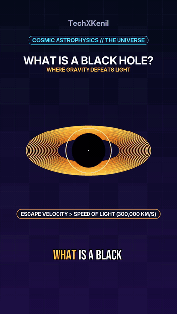
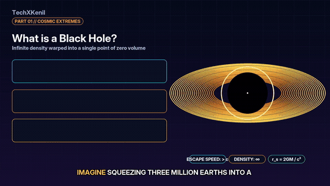
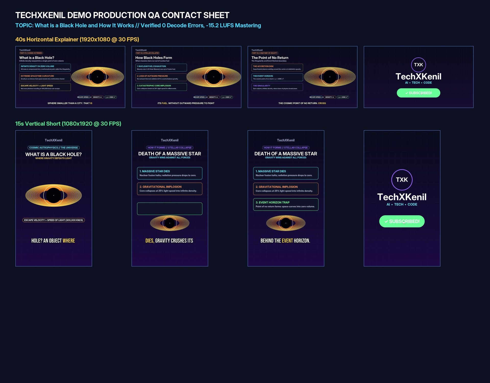
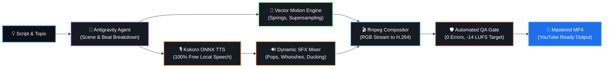

<div align="center">

# 🎬 TechXKenil Video Engine
### ⚡ Autonomous AI Faceless Video Production Suite

**Generate high-retention tech explainers and viral Shorts with local neural speech, sub-pixel physics, and automated QA gates—zero stock footage required.**

<br />

[](https://python.org)
[](https://deepmind.google)
[](https://github.com/thewh1teagle/kokoro-onnx)
[](https://ffmpeg.org)
[](LICENSE)
[](https://buymeacoffee.com/kenilribadiya)

<br />

[✨ Key Capabilities](#-key-capabilities) • [🎥 Live Demos](#-live-production-demos) • [🔄 Architecture Pipeline](#-autonomous-production-pipeline) • [⚡ 60s Quickstart](#-quickstart-in-60-seconds) • [📐 Video Standards](#-video-formats--standards) • [🎨 Design System](#-visual-design-system) • [☕ Support](#-support-the-creator)

</div>

---

<div align="center">

### 👨‍💻 Creator & Maintainer
| 👤 Lead Developer | 🌐 Portfolio | 📺 YouTube Channel | ☕ Buy Me a Coffee |
| :---: | :---: | :---: | :---: |
| **Kenil Ribadiya** | [kenilribadiya.in](https://kenilribadiya.in) | [@TechXKenil](https://www.youtube.com/@techxkenil) | [buymeacoffee.com/kenilribadiya](https://buymeacoffee.com/kenilribadiya) |

</div>

---

## 🎥 Live Production Demos

Experience autonomous AI video production generated with local neural voice synthesis, Pillow sub-pixel vector rendering, and dynamic motion graphics. Both demo videos play directly inline below:

<br />

### 📱 1. 15s Vertical YouTube Short (1080×1920 @ 30 FPS)
> **Topic:** *What is a Black Hole? (Gravity Trap & Singularity)*  
> **Key Features:** Bebas Neue Karaoke typography, 4-word chunking at `y=1560`, dynamic rotating accretion disk, and animated TechXKenil subscribe outro.

<div align="center">
  
</div>

<p align="center">
  <code>python VideoFiles/black_hole/render_vertical.py</code>
</p>

<br />

### 🖥️ 2. 40s Horizontal Explainer Video (1920×1080 @ 30 FPS)
> **Topic:** *How Black Holes Work (Cosmic Extremes to Stellar Collapse)*  
> **Key Features:** 4-part structured explainer, relativistic Doppler beaming, Inter Display Bold calm subtitles, and widescreen TXK brand lock.

<div align="center">
  
</div>

<p align="center">
  <code>python VideoFiles/black_hole/render_horizontal.py</code>
</p>

<br />

### 🔬 Technical Implementation Highlights
- **Accretion Disk & Relativistic Beaming:** Real-time multi-layered Doppler gradients (amber to deep violet), photon sphere boundary, and sub-pixel gravitational singularity.
- **Viral Shorts Typography:** High-retention Bebas Neue Bold (size 78) chunked strictly into 3–4 words per chunk at `y=1560`, with active word karaoke highlighting in yellow and zero margin overflows.
- **Calm Widescreen Subtitles:** Inter Display Bold (size 38) chunked into 6–7 words at `y=1000` with 540px+ breathing room on each side.
- **Official Brand Lock Outro:** Purple TXK ring circle, smooth quadratic Bezier cursor glide (`arc_point`), click ripple, and button transforming from red `SUBSCRIBE` into green `✓ SUBSCRIBED!`.
- **Automated QA Gate Passed:** 0 decode errors (`ffmpeg -v error -f null -`), -15.2 LUFS loudness mastering, and 0 static holds.

<details>
  <summary><b>🔍 Click to View Full Scene QA Contact Sheet (1920×1500 Keyframes)</b></summary>
  <br />
  <div align="center">
    
  </div>
</details>

---

## 🔄 Autonomous Production Pipeline

The entire video production lifecycle runs autonomously via **Google Antigravity** agents without human manual editing or third-party video editors:



---

## ✨ Key Capabilities

<table>
  <tr>
    <td width="50%" valign="top">
      <h3>🤖 Agent-First Architecture</h3>
      <p>Native configuration for <b>Google Antigravity</b> agents. Autonomous agents parse scripts, time scenes, synthesize audio, render frames, and validate quality gates without human intervention.</p>
    </td>
    <td width="50%" valign="top">
      <h3>🎙️ 100% Free Local Neural Voice</h3>
      <p>Zero API costs and complete offline privacy powered by <b>Kokoro v1.0 ONNX</b> (<code>am_michael</code> at 1.1× speed). Generates natural, studio-quality narration in seconds.</p>
    </td>
  </tr>
  <tr>
    <td width="50%" valign="top">
      <h3>🎨 Physics-Based Motion Graphics</h3>
      <p>Custom <code>motion.py</code> engine with <b>spring dampening</b> (~4% natural overshoot), <b>2× sub-pixel supersampling (SS)</b> via Lanczos downsampling, and temporal motion blur for buttery-smooth animations.</p>
    </td>
    <td width="50%" valign="top">
      <h3>🖥️ Real UI Screen Capture</h3>
      <p>Never renders synthetic mockups. Headless Chromium (<b>Playwright</b>) captures genuine website interfaces (GitHub, ChatGPT, Hugging Face) and renders authentic system terminals.</p>
    </td>
  </tr>
  <tr>
    <td width="50%" valign="top">
      <h3>🔤 Kinetic Viral Typography</h3>
      <p>High-contrast <b>Bebas Neue</b> captions with calibrated black stroke boundaries (<code>stroke_fill=(0, 0, 0)</code>) and word-by-word active karaoke highlighting calibrated to narration timing.</p>
    </td>
    <td width="50%" valign="top">
      <h3>🛡️ Mathematical QA Gate</h3>
      <p>Integrated <code>qa.py</code> automated gate verifies <b>zero decode errors</b> (<code>ffmpeg -v error -f null -</code>), enforces YouTube reference loudness (<b>-14.0 LUFS</b>), and flags static holds.</p>
    </td>
  </tr>
</table>

---

## ⚡ Quickstart in 60 Seconds

### 1️⃣ One-Command Installation
Clone the repository and run the automated setup script. It provisions the virtual environment, system binaries, neural models, and typography in a single execution:

```bash
git clone https://github.com/techXkenil/Faceless.git
cd Faceless
bash setup.sh
```

### 2️⃣ Autonomous Production with Antigravity
Open this workspace in **Antigravity** and issue a plain-English prompt:

```text
Make a 30s Short explaining "How AI Answers in Milliseconds" using the motion editing engine.
```

Or generate an in-depth long-form explainer:

```text
Create an 8-minute deep dive video on "Is Coding Still Worth It in the AI Era?" with full graphics and chapters.
```

### 3️⃣ Manual CLI Workflow
If you prefer running production manually:

```bash
# 1. Activate environment
source .venv/bin/activate

# 2. Synthesize neural narration & audio timeline
python VideoFiles/black_hole/tts_black_hole.py

# 3. Render 15s Vertical Short (1080×1920 @ 30 FPS)
python VideoFiles/black_hole/render_vertical.py

# 4. Render 40s Horizontal Explainer (1920×1080 @ 30 FPS)
python VideoFiles/black_hole/render_horizontal.py

# 5. Run automated QA verification gates
python tools/qa.py VideoFiles/black_hole/black_hole_vertical_15s.mp4 short
python tools/qa.py VideoFiles/black_hole/black_hole_horizontal_40s.mp4 long
```

---

## 📐 Video Formats & Standards

| Parameter | 📱 YouTube Short (9:16) | 🖥️ Long Explainer Video (16:9) |
| :--- | :--- | :--- |
| **Canvas Dimensions** | `1080 × 1920` (Vertical) | `1920 × 1080` (Horizontal) |
| **Frame Rate** | `30 FPS` | `24 FPS` (or `30 FPS`) |
| **Target Duration** | **30 seconds** (28–32s safe zone) | **8–10 minutes** (full structured deep-dive) |
| **Video Codec** | H.264 High Profile, `yuv420p`, BT.709 color-tagged | Same (`-movflags +faststart`) |
| **Audio Loudness** | **-14.0 LUFS** (±1 LUFS), -1.5 dBTP | **-14.0 LUFS** (±1 LUFS), -1.5 dBTP |
| **Audio Sample Rate** | 48 kHz AAC stereo/mono | 48 kHz AAC stereo/mono |
| **Burned-In Captions** | Bebas Neue (size 78–82), 3–4 words/chunk @ `y=1560` | Inter Display Bold (size 38–40), bottom center |

---

## 🎨 Visual Design System

The visual design system is engineered for maximum retention, instant clarity, and brand consistency:

| Color Role | Preview | Hex | RGB Value | Purpose |
| :--- | :---: | :---: | :---: | :--- |
| **Deep Space** | `⬛` | `#080C1C` | `(8, 12, 28)` | Canvas background gradient start |
| **Cosmic Purple** | `🟪` | `#1E1046` | `(30, 16, 70)` | Canvas background gradient end |
| **Grid Lines** | `🟦` | `#161C3A` | `(22, 28, 58)` | Subtle 90px technical graph grid |
| **White Core** | `⬜` | `#FFFFFF` | `(255, 255, 255)` | Primary headlines & card borders |
| **Cyan Accent** | `🔷` | `#46DCFF` | `(70, 220, 255)` | Metrics, highlights, tagline badges |
| **Karaoke Yellow**| `🟨` | `#FFCD46` | `(255, 205, 70)` | Active spoken word karaoke highlight |
| **Speed Green** | `🟩` | `#5AEB96` | `(90, 235, 150)` | Success states, performance advantages |
| **Warning Red** | `🟥` | `#FF465A` | `(255, 70, 90)` | Bottlenecks, errors, subscribe button |
| **Brand Purple** | `🟪` | `#966EFF` | `(150, 110, 255)` | Microchips, icon badges, TXK logo ring |

---

## 📁 Repository Architecture

```text
techxkenil-video-engine/
├── setup.sh                  # One-command automated installer
├── requirements.txt          # Python core dependencies
├── LICENSE                   # MIT License (Kenil Ribadiya)
├── README.md                 # Project documentation & showcases
├── .env.example              # Optional cloud provider keys
│
├── tools/                    # Shared production libraries
│   ├── motion.py             # Springs, supersampling, blur, keyframes
│   ├── humanize.py           # Easing, karaoke, SFX synthesizer, master()
│   ├── qa.py                 # Automated video & audio QA gate
│   └── capture_ui.py         # Headless Chromium screen capture & terminal generator
│
├── VideoFiles/               # Centralized local video suites (git-ignored, local only)
│
├── agents/                   # Agent configurations & knowledge base
│   ├── skills/               # Custom Antigravity skills
│   │   ├── techxkenil-motion-editing/ # Core motion graphics skill
│   │   ├── techxkenil-humanized-video/ # Humanized pacing & variation
│   │   ├── generate-thumbnail/         # High-CTR thumbnail generator
│   │   └── youtube-metadata/           # Algorithm SEO & chapter generator
│   └── md_files/             # Project guidelines & brand memory
│       ├── GEMINI.md         # Master channel production rules
│       └── brand.md          # Visual design system & color palettes
│
├── VideoFiles/               # Centralized local video suites (git-ignored)
├── fonts/                    # High-legibility typography (Inter, Bebas Neue)
└── media/                    # Showcase demos & permanent SFX library
```

---

## ☕ Support the Creator

If this autonomous AI video production suite helps your workflows or projects, consider supporting **Kenil Ribadiya** with a coffee:

<div align="center">

<a href="https://buymeacoffee.com/kenilribadiya" target="_blank">
  
</a>

<br /><br />

🔗 **[buymeacoffee.com/kenilribadiya](https://buymeacoffee.com/kenilribadiya)**

</div>

---

## 📄 License

This project is licensed under the **MIT License** — see the [LICENSE](LICENSE) file for complete details.

<div align="center">

Crafted with ❤️ by **[Kenil Ribadiya](https://kenilribadiya.in)** • Founder of **[TechXKenil](https://www.youtube.com/@techxkenil)**

</div>
